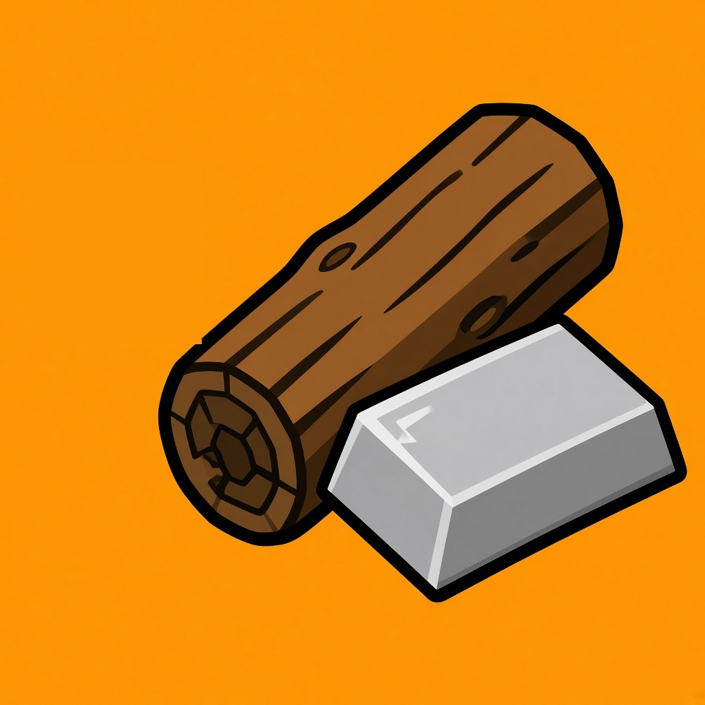

# Item menu



Need materials right now? Get any of them with a single click.

- Press I to open a catalog of every material in the game, sorted by name
- Click a material to put a full stack straight into your inventory
- Press I again or Escape to close

Perfect for testing builds or skipping the grind.

MelonLoader mod for Stellar Drive.

## Installation

Install it from the Stellar Mod Manager, or copy `ItemMenu.dll` from the latest release into the game's `Mods` folder. The game needs MelonLoader.

## Building from source

You need the .NET SDK (any version that can build `net472` projects) and Stellar Drive with MelonLoader installed. The project references the game's own assemblies, so nothing from the game is included in this repository.

```
dotnet build src/ItemMenu.csproj -c Release -p:GameDir="C:\Program Files (x86)\Steam\steamapps\common\StellarDrive Demo"
```

The DLL ends up in `src/bin/Release`. Add `-p:CopyToMods=true` to copy it into the game's `Mods` folder.

## How the code is organised

| File | What it does |
| --- | --- |
| `ItemMenu.cs` | Mod entry point: the I key |
| `ItemWindow.cs` | The catalog window, cloned from the game inventory, and adding a stack on click |
| `Shared/GameKeys.cs` | Keeps the I key away from the chat, text fields and game menus |

## License

MIT, see [LICENSE](LICENSE).
